  
  
  
  
  

### `> whoami`

I'm **Ghom** (Camille Abella), a French **full-stack & game developer**, available as a freelancer.
I build interfaces you can pilot, tools that get the job done and games that make your brain work —
from the database schema to the last animated pixel.

On the side, I run **[No Brain No Game](https://nobrainnogame.ghom.fr)**, a small studio making tactical and
strategy games you play right in the browser.

### `> ls ./projects`

<table>
  <tr>
    <td width="50%" valign="top">
      <h4><a href="https://devgame.nobrainnogame.ghom.fr">🎮 Devgame</a></h4>
      An <b>online incremental dev company simulator</b> played on a Git graph. Ship tickets by hand or with the AI,
      survive the review, pay your team — solo or with others.
        
      <a href="https://devgame.nobrainnogame.ghom.fr">Play</a> · <a href="https://github.com/NoBrainNoGame/devgame">Source</a>
    </td>
    <td width="50%" valign="top">
      <h4><a href="https://ghom.fr">🛰️ ghom.fr</a></h4>
      My hub: a three.js cockpit you pilot, the No Brain No Game portal and their admin console,
      in one Bun + Turbo monorepo on Next.js 16.
        
      <a href="https://ghom.fr">Visit</a> · <a href="https://github.com/GhomKrosmonaute/ghom-hub">Source</a>
    </td>
  </tr>
  <tr>
    <td width="50%" valign="top">
      <h4><a href="https://github.com/bot-ts/framework">🤖 Bot.ts</a></h4>
      The most comfortable <b>discord.js</b> framework, in TypeScript — with a CLI that scaffolds your bot,
      its commands, listeners and tables. Runs on Node, Bun and Deno.
        
      <a href="https://ghom.gitbook.io/bot.ts">Docs</a> · <a href="https://github.com/bot-ts/framework">Source</a> · <a href="https://www.npmjs.com/package/@ghom/bot.ts-cli">npm</a>
    </td>
    <td width="50%" valign="top">
      <h4><a href="https://nobrainnogame.ghom.fr">🧠 No Brain No Game</a></h4>
      The studio: browser games that make you think, released as they mature —
      from prototypes to games you can play right now.
        
      <a href="https://nobrainnogame.ghom.fr">Catalogue</a> · <a href="https://github.com/NoBrainNoGame">GitHub</a>
    </td>
  </tr>
</table>

### `> cat ./loadout`

  
  
  
  
  
  
  
  
  
  
  
  
  
  

### `> status --github`

  
  

<b>Older portfolios</b> — the previous versions of my website, kept online

 

| Version | Year | What's in it |
|---|---|---|
| [**v3**](https://ghomkrosmonaute.github.io/v3/) | 2025 | A portfolio with a full card game in it |
| [**v2**](https://ghomkrosmonaute.github.io/v2/) | 2024 | My 2024 portfolio |
| [**v1**](https://ghomkrosmonaute.github.io/v1/) | 2020 | Where it all started |

<b>Communities</b>

 

- [Ghom's Discord](https://discord.gg/kYxDWWQJ8q) — news about my tools and games
- [JavaScript community](https://discord.gg/3vC2XWK) — a French-speaking JavaScript server

Stats redrawn every day by a <a href=".github/workflows/stats.yml">workflow</a> — no third-party service.

